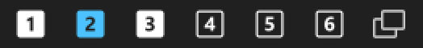
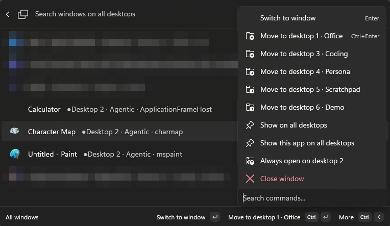
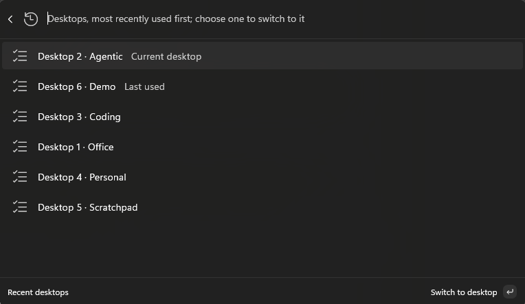
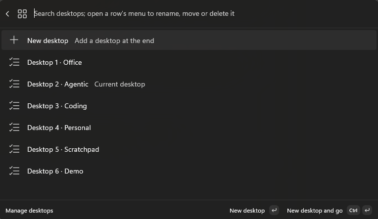
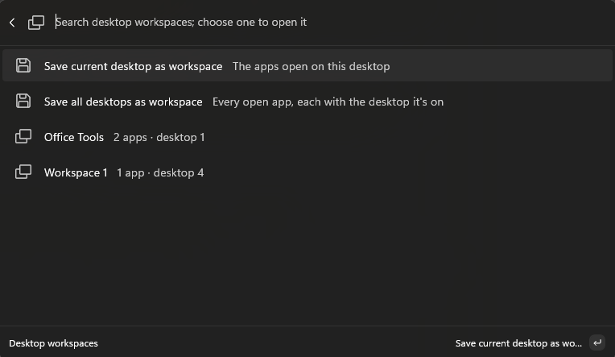

# Desktop Tiler for Command Palette

A PowerToys Command Palette extension for working with Windows virtual desktops from the **Dock** and the palette: switch, create, rename, reorder and delete desktops; see and move the windows on every desktop; send an app's new windows to its own desktop; save and restore sets of apps per desktop; and tile windows, one shortcut at a time.

> Unofficial community project. Not affiliated with or endorsed by Microsoft.





<sub>Rows of the author's own windows are pixelated.</sub>

- **In the Dock:** a *Desktops* band with one button per Windows virtual desktop (`1`, `2`, `3`...), the active one's square drawn in blue (and, when names are shown, marked `●` with a bold number), optionally subtitled with the desktop's name. Each button's icon shows whether that desktop has any app windows on it: a filled square if it does, an outlined one if it's empty (minimized windows count). Click a button to switch. Updates live as you switch, add, remove, or rename desktops, and as windows open, close, or move between desktops. The last button (stacked windows icon) opens **All windows**. With a Compact Dock, hovering a desktop button lists the windows on it.
- **All windows:** every app window on every desktop, grouped by desktop in order, with the desktop number/name and app in the subtitle. Type to filter; pick one to switch to its desktop and bring it to the front. Each row's context menu (right-click or <kbd>Ctrl</kbd>+<kbd>K</kbd>) can bring the window to the current desktop, move it to another desktop, show it on all desktops (or only on one again), show every window of its app on all desktops - including ones opened later, the same as Task View's "Show windows from this app on all desktops", and it works for Store apps too - or close it. Open it from the Dock button or bind a hotkey to it.
- **Move windows:** `Move window to desktop 1`...`9`, `Move window to next desktop`, `Move window to previous desktop` send the active window to that desktop and keep you where you are; the `... and go` variants take you along and bring the window to the front - bind hotkeys to them (see [Suggested hotkeys](#suggested-hotkeys)).
- **Manage desktops:** `New desktop` (and `New desktop and go`), `Rename current desktop`, `Move current desktop left` / `right`, and `Delete current desktop`. The `Manage desktops` page lists every desktop; each row's context menu (<kbd>Ctrl</kbd>+<kbd>K</kbd>) renames, moves or deletes that desktop. Deleting asks first and moves the desktop's windows to its left neighbour (the second desktop if it was the first); the last desktop can't be deleted.
<table>
<tr>
<td></td>
<td></td>
</tr>
<tr>
<td align="center"><code>Recent desktops</code></td>
<td align="center"><code>Manage desktops</code></td>
</tr>
</table>

- **Window rules:** make an app's new windows open on a chosen desktop. In `All windows`, pick **Always open on desktop N** from a window's menu (<kbd>Ctrl</kbd>+<kbd>K</kbd>); the rule follows that desktop even if it's renamed or moved. A ruled window appears briefly where it was opened, then moves (about half a second); you stay where you are, and the keyboard focus stays on your desktop. Windows already open, and windows you later move by hand, are left alone. The `Window rules` page lists the rules: choose one to pick another desktop, or delete it from its menu. Rules match the executable (e.g. `OUTLOOK.EXE`); Store apps all share one host process, so they can't have rules, and windows running as administrator can't be moved.


- **Desktop workspaces:** `Save current desktop as workspace` saves the apps open on the current desktop; `Save all desktops as workspace` saves every open app with the desktop it's on; `Open desktop workspace: <name>` (one command per workspace, so it can have a hotkey) brings it back. Apps already running have their windows moved to their desktop; the others are started and their new windows moved there as they appear. You stay where you are. The `Desktop workspaces` page opens, renames, edits (change an app's desktop, set the command-line arguments it's started with - e.g. a folder for your editor - or remove an app) and deletes workspaces. Arguments are set by hand from an app's menu (<kbd>Ctrl</kbd>+<kbd>K</kbd>) in `Edit apps`; they're used only when the app is started, not when it's already running. Store apps can't be part of a workspace.
- **Switch desktops:** `Desktop 1`...`Desktop 9`, `Next desktop`, `Previous desktop`, and `Last used desktop`, which flips between the two most recent desktops (like Alt+Tab; if that desktop was deleted, it goes to the one used before it) - bind hotkeys to them in Command Palette settings. `Recent desktops` lists the desktops most recently used first; choose one to switch to it. The order is kept while the extension runs and starts over when Command Palette restarts.
- **Tile windows, once:** `Tile: Master-stack`, `Tile: Columns`, `Tile: Grid`, `Tile: Monocle`, `Tile: Center-master` arrange the tileable windows on the focused monitor into that layout. `Tile: Next layout` cycles through them in that order. `Tile: Retile` re-applies whatever you last tiled with, keeping window order - if you clicked a different window first, that window becomes master. `Tile: Rotate` shifts the remembered window order by one step, so the next window in line becomes master; press it repeatedly until the one you want is in the master (or center) slot. After each pass, the layout's name and the result (e.g. **Grid** · *Tiled 4 windows*) flash briefly in the middle of that monitor, on top of the windows just moved; it doesn't take focus and clicks pass through it.

Tiling is **one-shot, not continuous**: nothing is watched or re-tiled automatically. Open or close a window, then press the tile command again. Each pass only touches the monitor of the currently focused window, and only the current virtual desktop; window order is remembered per desktop+monitor for as long as the extension keeps running.

## Requirements

- Windows 11 24H2 (build 26100) or later - the package can't be installed on older builds; see [Limitations](#limitations)
- PowerToys with Command Palette **0.9 or later** (Dock support)

## Installation

**Microsoft Store:** Desktop Tiler is being submitted to the Microsoft Store; once the listing is live, it will be linked here and installing it there is the easiest way (no certificate, automatic updates). Until then, install it from GitHub as below. Either way, do step 1 first.

### 1. Turn on the Dock

1. Install or update [PowerToys](https://github.com/microsoft/PowerToys/releases) and make sure **Command Palette** is enabled in PowerToys Settings.
2. Open Command Palette (default <kbd>Win</kbd>+<kbd>Alt</kbd>+<kbd>Space</kbd>) → **Settings** → **Dock (Preview)** → turn on **Enable Dock**.

> **Upgrading from v0.1 or v0.2?** Those used a different package identity. Remove them first (`Get-AppxPackage DesktopTiler | Remove-AppxPackage`), then install as below. Your settings reset to their defaults.

### 2. Download

From the [Releases page](https://github.com/xmsadik/desktop-tiler-cmdpal/releases) (newest release at the top) download:
- `DesktopTiler.cer`
- the package for your CPU: `DesktopTiler_<version>_x64.msix` (Intel/AMD) or `DesktopTiler_<version>_arm64.msix` (Arm, e.g. Snapdragon). Not sure? Run `$env:PROCESSOR_ARCHITECTURE` in PowerShell: `AMD64` → x64, `ARM64` → arm64.

### 3. Trust the certificate (once per machine)

The package is signed with a self-signed certificate, so Windows has to be told to trust it. In **PowerShell as Administrator**, in the download folder:

```powershell
Import-Certificate .\DesktopTiler.cer -CertStoreLocation Cert:\LocalMachine\TrustedPeople
```

### 4. Install

In a normal PowerShell window (or double-click the `.msix` and choose *Install*):

```powershell
Add-AppxPackage .\DesktopTiler_<version>_x64.msix
```

From a clone of this repository, `.\scripts\install.ps1 -Path .\DesktopTiler_<version>_x64.msix` installs it and also restarts Command Palette the way step 5 needs (see [Troubleshooting](#troubleshooting)).

### 5. Show it in the Dock

1. Open Command Palette and run **Reload** so it picks up the new extension.
2. The *Desktops* band usually appears in the Dock by itself. If it doesn't, search for **Desktop Tiler** in Command Palette, open its context menu and run **Pin to Dock** (choose the side you like, e.g. *Right*).
3. Click the band to switch desktops. Bind hotkeys to the tiling and desktop-switching commands (see [Suggested hotkeys](#suggested-hotkeys)). Settings: search **Desktop Tiler** → *Settings*.

### Update

Download the newer `.msix` and run `Add-AppxPackage` again; the certificate step isn't needed again. Then **Reload** Command Palette.

### Uninstall

```powershell
Get-AppxPackage ABAPer.DesktopTiler | Remove-AppxPackage
# optional, as Administrator: remove the trusted certificate
Get-ChildItem Cert:\LocalMachine\TrustedPeople | Where-Object Subject -eq 'CN=48947E55-115C-445B-9841-39A5BCF271DD' | Remove-Item
```

### Troubleshooting

| Symptom | Fix |
|---|---|
| `0x800B0109` / "the root certificate … is not trusted" on install | Step 3 was skipped or not run as Administrator. |
| `0x80073CFB` / "a package with the same identity is already installed" | A development build is registered: `Get-AppxPackage ABAPer.DesktopTiler \| Remove-AppxPackage`, then install again. |
| Band doesn't appear | Check **Enable Dock** is on, run **Reload**, then use **Pin to Dock** as in step 5. |
| Right after installing or updating, the band is missing or hotkeys do nothing | The first start of new files can be slow (antivirus scanning them); Command Palette stops waiting after 10 s and the extension then loads without its band and hotkeys. Quit Command Palette completely and start it again (a warm start is fast). `scripts\install.ps1` does this for you and checks Command Palette's log that the extension loaded. |
| Toast says "Unsupported Windows build for desktop switching" | Your Windows build's undocumented virtual-desktop COM layout doesn't match what this extension expects - see [Limitations](#limitations). Wait for an update, or check the project's issues. |
| A window is reported "skipped (admin)" | The window belongs to an elevated (Run as administrator) process; a non-elevated extension can't move it - see [Limitations](#limitations). |
| Clicking the band opens the palette instead of the flyout, or it stops updating | Command Palette host issues, see [Known host issues](#known-host-issues). **Reload** fixes both. |

## Commands

| Command | Id |
|---|---|
| Desktop 1 ... Desktop 9 | `DesktopTiler.desktop.1` ... `DesktopTiler.desktop.9` |
| Next desktop | `DesktopTiler.desktop.next` |
| Previous desktop | `DesktopTiler.desktop.prev` |
| Last used desktop | `DesktopTiler.desktop.last` |
| Recent desktops | `DesktopTiler.desktops.recent` (page) |
| Move window to desktop 1 ... 9 | `DesktopTiler.move.1` ... `DesktopTiler.move.9` |
| Move window to next desktop | `DesktopTiler.move.next` |
| Move window to previous desktop | `DesktopTiler.move.prev` |
| Move window to desktop 1 ... 9 and go | `DesktopTiler.moveandgo.1` ... `DesktopTiler.moveandgo.9` |
| Move window to next / previous desktop and go | `DesktopTiler.moveandgo.next` / `DesktopTiler.moveandgo.prev` |
| Tile: Master-stack | `DesktopTiler.tile.masterstack` |
| Tile: Columns | `DesktopTiler.tile.columns` |
| Tile: Grid | `DesktopTiler.tile.grid` |
| Tile: Monocle | `DesktopTiler.tile.monocle` |
| Tile: Center-master | `DesktopTiler.tile.centermaster` |
| Tile: Next layout | `DesktopTiler.tile.next` |
| Tile: Retile | `DesktopTiler.tile.retile` |
| Tile: Rotate | `DesktopTiler.tile.rotate` |
| All windows | `DesktopTiler.windows` (page) |
| New desktop | `DesktopTiler.desktop.new` |
| New desktop and go | `DesktopTiler.desktop.new.go` |
| Rename current desktop | `DesktopTiler.desktop.rename` (page) |
| Move current desktop left | `DesktopTiler.desktop.moveleft` |
| Move current desktop right | `DesktopTiler.desktop.moveright` |
| Delete current desktop | `DesktopTiler.desktop.delete` |
| Manage desktops | `DesktopTiler.desktops.manage` (page) |
| Window rules | `DesktopTiler.rules` (page) |
| Save current desktop as workspace | `DesktopTiler.workspace.save.current` |
| Save all desktops as workspace | `DesktopTiler.workspace.save` |
| Desktop workspaces | `DesktopTiler.workspaces` (page) |
| Open desktop workspace: *name* | `DesktopTiler.workspace.open.<id>` (one per workspace) |
| Desktop Tiler settings | (settings page) |

Ids are stable across releases, so a hotkey bound to one keeps working; `Desktop 3`, for example, always means "the 3rd desktop in display order right now", not a specific desktop that might later be removed.

### Suggested hotkeys

Bind these in Command Palette → *Settings* → *Commands*:

| Hotkey | Command |
|---|---|
| <kbd>Alt</kbd>+<kbd>1</kbd>...<kbd>9</kbd> | Desktop 1...9 |
| <kbd>Win</kbd>+<kbd>Alt</kbd>+<kbd>Shift</kbd>+<kbd>1</kbd>...<kbd>9</kbd> | Move window to desktop 1...9 |
| <kbd>Win</kbd>+<kbd>Ctrl</kbd>+<kbd>Alt</kbd>+<kbd>1</kbd>...<kbd>9</kbd> | Move window to desktop 1...9 and go |
| <kbd>Win</kbd>+<kbd>Alt</kbd>+<kbd>R</kbd> | Tile: Retile |
| <kbd>Win</kbd>+<kbd>Alt</kbd>+<kbd>O</kbd> | Tile: Rotate |

The first three rows are in daily use on Windows 11 24H2. Some combinations can't be used:
- <kbd>Win</kbd>+*number* together with only <kbd>Alt</kbd>, <kbd>Ctrl</kbd>, <kbd>Shift</kbd> or <kbd>Ctrl</kbd>+<kbd>Shift</kbd> belongs to Windows (taskbar shortcuts): Command Palette can't register it, and its log shows `Failed to register hotkey ... Error: 1409`.
- <kbd>Win</kbd>+<kbd>Alt</kbd>+<kbd>Space</kbd> opens Command Palette itself by default.
- <kbd>Alt</kbd>+*number* is also used by a few apps for their own tabs; the global hotkey wins while it's bound.

## Settings

Command Palette → *Desktop Tiler* → *Settings*:
- **Default layout**: the layout `Tile: Retile` and `Tile: Next layout` start from before anything has been tiled this session (default Master-stack).
- **Master ratio**: how much of the work area the master pane takes up, for Master-stack and Center-master, 40-70% (default 55%).
- **Gap**: space left between tiled windows and the work area's edge: 0, 4, 8, 12, or 16 px (default 8 px).
- **Switch animation**: animate when switching desktops (default off: switches are instant).
- **Show desktop names**: show desktop names as the Dock band's subtitles (default on).

## Limitations

- Desktop switching and tiling use undocumented Windows virtual-desktop COM interfaces, pinned to the layout observed on Windows 11 24H2 (build 26100). On other builds these interfaces may differ, and commands show an "Unsupported Windows build" toast until an update adds support for that build.
- An elevated (Run as administrator) window can't be moved from this extension's non-elevated process; it's reported as "skipped (admin)" instead of tiled.
- Each tile pass only arranges windows on a single monitor - the one the focused window is on.
- A window with a large minimum size may not fully fit its assigned cell and can overflow it.

## Build from source

Needs the .NET 10 SDK. A full Windows SDK / Visual Studio is **not** required.

```powershell
dotnet test tests\DesktopTiler.Tests -p:Platform=x64      # unit tests
.\scripts\dev-deploy.ps1                                  # build + register (Developer Mode on)
.\scripts\dev-deploy.ps1 -Remove                          # unregister
```

After deploying, run **Reload** in Command Palette. If the band does not appear by itself, use **Pin to Dock** (see [Installation](#5-show-it-in-the-dock)).

Without Developer Mode, build a signed package and install it in one go:

```powershell
.\scripts\pack.ps1 -Sign -Install   # raises the manifest version, packs, signs, installs, restarts Command Palette
.\scripts\install.ps1               # install the newest dist\ package and restart Command Palette
```

`install.ps1` runs the new `DesktopTiler.exe` once so it gets scanned, restarts Command Palette, then reads Command Palette's log (`%LOCALAPPDATA%\Microsoft\PowerToys\CmdPal\Logs`): if it reports that it gave up waiting for the extension, it restarts Command Palette once more.

### MSIX package

```powershell
.\scripts\pack.ps1 -Sign        # dist\...\DesktopTiler_<ver>_x64.msix + dist\DesktopTiler.cer
.\scripts\pack-store.ps1       # dist\store\DesktopTiler_<ver>_Bundle.msixbundle (unsigned, x64 + ARM64, for Partner Center)
```

`-Platform ARM64` builds the Arm package. The first `-Sign` run creates a self-signed code-signing certificate for the manifest's publisher in `Cert:\CurrentUser\My` and reuses it afterwards. `scripts/make-icons.py` (needs Pillow) regenerates every image in `src/DesktopTiler/Assets`. Install the result as described in [Installation](#installation).

## Layout

```
src/DesktopTiler/        Command Palette extension (Dock band, pages, commands, settings, Tiler)
src/DesktopTiler.Core/   Plain .NET library: virtual desktop COM/registry, windows, layouts,
                         window rules and desktop workspaces (models and storage)
tests/DesktopTiler.Tests xUnit tests for Core
scripts/                 dev-deploy.ps1, pack.ps1, pack-store.ps1, install.ps1, icon generators
```

## Known host issues

These are Command Palette bugs, not bugs in this extension:
- [#50367](https://github.com/microsoft/PowerToys/issues/50367): after the host releases an idle extension, clicking a band opens the palette instead of the flyout.
- [#49688](https://github.com/microsoft/PowerToys/issues/49688): bands stop repainting after roughly 41 hours of uptime.

Running **Reload** in Command Palette works around both.

## Privacy

Desktop Tiler has no network access and collects no data. The window rules and desktop workspaces you create are saved only on your device, in the extension's own folder. See [PRIVACY.md](PRIVACY.md).

## License

[MIT](LICENSE). Parts derived from the PowerToys extension template are © Microsoft, MIT; the virtual desktop COM interface definitions are based on Markus Scholtes' VirtualDesktop project, MIT; see [NOTICE](NOTICE).
